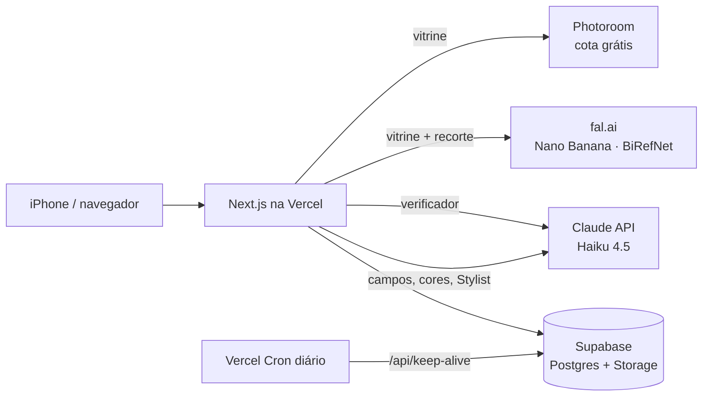

# MUSE: guarda-roupa digital com IA

Um app pessoal que transforma fotos de roupas em um armário digital organizado e usa IA para montar looks com as peças que você **já tem**.

**App publicado:** [muse-app-sooty.vercel.app](https://muse-app-sooty.vercel.app). Ele foi pensado pra uso no celular, e eu uso o app adicionado à tela inicial do iPhone.

> Projeto construído do zero por mim (designer, iniciante em programação), com o Claude como par de programação: da discovery ao app publicado.

---

## O problema

Eu amo moda e gosto de me vestir diferente. Mas, com muita roupa, acabava sempre nos mesmos looks, porque é difícil **lembrar e visualizar** tudo o que se tem, principalmente acessórios e sapatos. A pesquisa secundária que fiz na discovery mostrou que isso é comum: a maioria das pessoas usa regularmente só uma pequena parte do próprio guarda-roupa.

A discovery separou duas dores diferentes:

1. **Falta de visão:** não lembrar o que tem.
2. **Preguiça de decidir:** mesmo sabendo o que tem, falta energia pra combinar.

O MUSE ataca a primeira com um armário visual e organizado e a segunda com o **Stylist IA**.

## O que o app faz

| Fluxo | Como funciona |
|---|---|
| **Cadastrar peça por foto** | Você tira uma foto ou escolhe da galeria. Em ~2 s a IA sugere tipo, subtipo, ocasião, peso e cores da peça, enquanto a foto ganha um efeito "vitrine" em segundo plano. Você revisa e salva. Depois, qualquer peça pode ser editada. |
| **Armário** | Peças agrupadas por tipo, com filtros por subtipo, ocasião, cor e peso, e opção de favoritar. |
| **Montar look** | Editor em tela cheia, inspirado no collage do Pinterest. Você adiciona peças por uma gaveta com filtros por tipo, arrasta com um dedo e muda o tamanho com **pinça de dois dedos** (como no Canva). O fundo de cada peça sai sozinho. Tocando numa peça aparecem as ações **Trocar**, **Trocar com IA**, Duplicar, Frente/Trás e Excluir. Tem também lixeira ao arrastar e desfazer/refazer. |
| **Stylist IA** | Você escolhe ocasião e peso, ou escreve um pedido livre, e a IA monta até 3 looks **só com peças do seu armário**, cada um com um nome curto. Cada peça da sugestão pode ser trocada individualmente, e o look pode ser salvo. |
| **"Usei hoje"** | Cada look tem um botão pra registrar que foi usado. O card mostra quantas vezes e quando foi usado pela última vez. |
| **Perfil** | Números do armário, **quanto % do armário já foi vestido** (a partir do "Usei hoje") e as **peças esquecidas**, que ainda não entraram em nenhum look. |

## Como a IA é usada

São quatro pontos de IA. Cada um tem uma função específica e passa por uma validação antes de chegar na tela.

1. **Foto de vitrine.** A foto vira uma imagem de catálogo. A peça aparece "vestida" por um manequim invisível, mesmo se a foto foi tirada vestindo a roupa no espelho, com ela na cama ou no cabide. Isso funciona com uma **cadeia de fornecedores com verificação**: primeiro a **Photoroom** com chave de produção (cota grátis mensal); depois o **Nano Banana** no fal.ai (~US$ 0,04). **Cada vitrine gerada passa por um verificador**: o Claude compara a foto original com a vitrine e reprova se apareceu corpo, se o comprimento ou a cor mudou ou se virou outra peça. Reprovou? O app tenta o **Nano Banana Pro** (~US$ 0,15). Se nada passar, usa um **recorte fiel** da foto real (BiRefNet), que nunca inventa a peça. A Photoroom sandbox (com marca d'água) é o último recurso. Se a vitrine da Photoroom alterar a peça, o botão **"A IA mudou a peça? Usar a foto real"** troca pela versão recortada. O cadastro nunca quebra por falta de cota, e os logs registram qual serviço gerou cada foto.
2. **Preenchimento automático (Claude Haiku 4.5, com visão).** A foto original (reduzida) vai pro Claude **ao mesmo tempo** que vai pra geração da vitrine, junto com as categorias e ocasiões que *a própria usuária* já usa. Ele devolve um JSON com tipo, subtipos, ocasiões, peso e **1–2 cores escolhidas de uma paleta com nomes** (com regras como "metal amarelado é Dourado"). O app aceita só valores das listas. A cor por média de pixels ficou só como plano B.
3. **Recorte automático nos looks (fal.ai BiRefNet).** Ao entrar num look, cada peça tem o fundo removido sozinha, pra que as peças possam se sobrepor sem quadrados brancos. **Cada foto é recortada uma vez só**: o recorte fica guardado e é reaproveitado em todos os looks, sem custo.
4. **Stylist IA e "Trocar com IA" (Claude Haiku 4.5).** O armário vai pro Claude como uma lista de texto (id, tipo, cores pelo nome, ocasiões, peso), sem imagens, o que deixa a chamada mais barata e rápida. Ele devolve looks como listas de ids, com um nome curto e uma frase explicando a combinação; no editor, sugere a substituta de uma peça mantendo o resto do look. **O servidor descarta qualquer id que não exista no armário**, então a IA não consegue "inventar" uma peça que você não tem.

## Arquitetura



- As **chaves das APIs ficam só no servidor** (variáveis de ambiente da Vercel). O navegador nunca vê as chaves.
- **Supabase:** `pieces` guarda as peças, `outfits` guarda os looks (com posição, tamanho e camada de cada peça), `usos` guarda os registros de "Usei hoje", e o bucket `fotos-pecas` guarda as imagens: vitrines, fotos originais e recortes sem fundo.
- **Keep-alive:** o plano gratuito do Supabase pausa o projeto depois de ~7 dias sem uso. Um Cron da Vercel chama `/api/keep-alive` todo dia pra manter o banco ativo.

## Stack

- **Next.js** (App Router) + **TypeScript** + **Tailwind CSS v4**
- **Supabase** (Postgres + Storage)
- **Vercel** (hospedagem, rotas de API e Cron)
- **Claude API** (`claude-haiku-4-5`)
- **fal.ai** (Nano Banana e Nano Banana Pro pra vitrine; BiRefNet pra recorte)
- **Photoroom API** (Image Editing v2)

## Decisões de produto

- **Trocar peça por peça, em vez de aceitar ou recusar o look inteiro.** A discovery mostrou que a usuária confia na IA de forma *condicional*: usa a sugestão como ponto de partida e ajusta alguma coisa. Por isso, cada peça sugerida tem o próprio botão de troca, e o editor de looks tem um **"Trocar com IA"**.
- **"Peso da peça" no lugar de "estação do ano".** Em Recife quase não existem estações marcadas, então classificar por verão ou inverno não fazia sentido. Troquei por *Leve / Neutra / Quente*, que é como eu realmente escolho a roupa.
- **A IA sugere e você confirma.** Os campos preenchidos pela IA são sempre editáveis, antes e depois de salvar. Nenhum tipo nem cor vem marcado por padrão: se a IA falhar, você percebe e escolhe, em vez de a peça ser salva errada sem ninguém notar.
- **Editor de looks inspirado no Pinterest.** Analisei o fluxo de collage do Pinterest (a inspiração original da tela) e trouxe o modo de criação em tela cheia, a gaveta de peças, a barra de ações da peça selecionada e a lixeira ao arrastar. O "trocar item" do Pinterest virou **"Trocar com IA"** no MUSE.
- **Medir uso, não só cadastro.** O "Usei hoje" existe pra responder à pergunta da discovery com dados do próprio armário: quanto do que eu tenho eu realmente visto?
- **Começar manual e automatizar depois.** O roadmap foi V1 (cadastro manual + looks), depois V2 (vitrine + tags por IA) e depois V3 (Stylist). O Stylist só fica bom quando o armário já tem dados bem estruturados.

## Desafios técnicos (e como resolvi)

- **Marca d'água × custo × fidelidade.** O plano da Photoroom que gera a vitrine custa US$ 100/mês, o que não faz sentido pra um app pessoal. Usei primeiro a cota grátis da chave de produção (10 fotos/mês), com volta automática pra sandbox quando ela acaba. Depois testei uma alternativa paga por foto: o Gemini 2.5 Flash Image (via fal.ai), um modelo generativo genérico, com instrução reforçada pra não alterar a peça. **No uso real ele falhou:** alongou um short curto e chegou a desenhar um corpo vestindo a peça. Primeiro troquei por um recorte fiel, mas o efeito de manequim fazia falta. A solução final foi **gerar e conferir**: reescrevi a instrução (a foto pode ter a pessoa vestindo a peça, e ela deve sumir; fidelidade vem antes), comparei 3 modelos com fotos reais (um deles recusou selfies no espelho) e coloquei o **Claude como verificador** de cada vitrine, com o recorte fiel como rede de segurança. Uma lição no caminho: o primeiro verificador era rígido demais e reprovava peças boas por detalhes de bolso, então ele passou a reprovar só erros graves.
- **Cadastro por foto lento.** A espera até poder salvar uma peça era de ~17 s no celular. Medi cada etapa e encontrei três problemas: (1) as etapas rodavam em fila; (2) as fotos eram salvas em PNG de 0,7 a 2,6 MB, mesmo tendo fundo branco; (3) a imagem fazia uma ida e volta extra pelo banco. Coloquei a IA dos campos pra rodar em paralelo, passei a salvar em JPEG de até 1200 px e fiz o servidor entregar a imagem direto pro celular. Resultado, medido no iPhone: campos em ~2 s e espera até salvar de ~10 s (a geração da vitrine varia de uma vez pra outra).
- **Cores erradas.** Um acessório dourado era salvo como "Preto": o Preto vinha marcado por padrão, a cor era calculada pela média dos pixels (que vira um tom "lamacento" em peças com brilho), a paleta não tinha dourado e o Stylist recebia códigos de cor em vez de nomes. Troquei por uma paleta com nomes, cores sugeridas pela visão do Claude e nomes enviados ao Stylist.
- **Bug que só aparecia no iPhone.** O seletor de cor do iOS avisa o app a cada movimento do dedo no espectro, e cada tom intermediário virava uma cor nova (dezenas de marrons). Passei a registrar a cor só quando o seletor fecha e limitei as cores personalizadas.
- **Foto de vitrine × montagem de looks.** A vitrine tem fundo branco, que tampava as peças sobrepostas no look. Separei os momentos: o Armário usa a vitrine e o look usa um recorte sem fundo, gerado automaticamente e guardado uma vez por foto.
- **O app quebrou sem nenhuma mudança no código.** Depois de semanas sem uso, o cadastro passou a falhar com "fetch failed" e o Stylist com uma mensagem genérica. Pelos logs da Vercel, descobri duas causas independentes: o banco tinha sido pausado pelo plano gratuito do Supabase e a chave da API do Claude estava inválida. Restaurei o banco, troquei a chave e criei o keep-alive diário.

## Custos

Para uso pessoal (uma usuária), o custo é muito baixo:

- **Claude API:** ~US$ 0,12 no total desde o início do projeto (US$ 5 de crédito inicial, saldo de US$ 4,88 em 28/10/2026).
- **fal.ai:** recarga única de US$ 10. Vitrine ~US$ 0,04 por peça (~US$ 0,15 quando precisa do Pro); recortes custam fração de centavo. O verificador (Claude Haiku) custa fração de centavo por vitrine.
- **Photoroom:** 10 fotos grátis por mês (chave de produção) + sandbox grátis como última reserva.
- **Supabase e Vercel:** planos gratuitos.

## Limitações conhecidas

- **Sem login:** o app foi feito pra uma única usuária. As regras de acesso do banco estão abertas e precisam filtrar por usuário antes de o app ter outras pessoas usando.
- Testado até agora só por mim.
- O verificador também é uma IA: pode deixar passar uma diferença ou reprovar uma vitrine boa. Por isso o botão "Usar a foto real" continua disponível.

## Próximos passos

- Login e dados separados por usuária, pra abrir o app pra outras pessoas.
- **Seções de looks** (Trabalho, Festa…), como as pastas do Pinterest.
- Usar o histórico do "Usei hoje" no Stylist: priorizar peças paradas e evitar repetir o look de ontem.
- A IA aprender o estilo da usuária a partir dos looks salvos.
- **"Achados":** fotografar um look visto na rua e encontrar peças parecidas, cruzando primeiro com o que já existe no armário.

## Rodando localmente

```bash
npm install
# crie um arquivo .env.local com as variáveis abaixo
npm run dev
```

Variáveis necessárias: `NEXT_PUBLIC_SUPABASE_URL`, `NEXT_PUBLIC_SUPABASE_ANON_KEY`, `PHOTOROOM_API_KEY` (chave sandbox da Photoroom) e `ANTHROPIC_API_KEY`. Opcionais: `PHOTOROOM_LIVE_API_KEY` (chave de produção, sem marca d'água; usada primeiro) e `FAL_KEY` (fal.ai: vitrine quando a cota da Photoroom acaba, recorte fiel e recorte dos looks). Os scripts SQL do banco ficam na pasta `supabase/`: rode primeiro o `schema.sql` e o `storage.sql`, depois as migrações.

---

Feito por **Marina Carvalho Xavier**, estudante de Design na UFPE.
