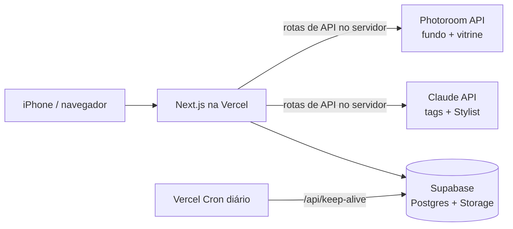

# MUSE: guarda-roupa digital com IA

Um app pessoal que transforma fotos de roupas em um armário digital organizado e usa IA para sugerir looks com as peças que você **já tem**.

**App publicado:** [muse-app-sooty.vercel.app](https://muse-app-sooty.vercel.app). Ele foi pensado pra uso no celular e eu uso adicionado à tela inicial do iPhone.

> Projeto construído do zero por mim (designer, iniciante em programação), com a ajuda do Claude como par de programação: da discovery ao app publicado.

---

## O problema

Quem tem muita roupa costuma repetir sempre os mesmos looks, porque é difícil **lembrar e visualizar** tudo o que tem. Isso vale principalmente pra acessórios e sapatos. A pesquisa secundária que fiz na discovery apontou que a maioria das pessoas usa regularmente só uma pequena parte do próprio guarda-roupa.

A discovery separou duas dores diferentes:

1. **Falta de visão:** a pessoa não lembra o que tem.
2. **Preguiça de decidir:** mesmo sabendo o que tem, falta energia pra combinar.

O MUSE ataca a primeira com um armário visual e organizado e a segunda com o **Stylist IA**.

## O que o app faz

| Fluxo | Como funciona |
|---|---|
| **Cadastrar peça por foto** | Você tira uma foto ou escolhe da galeria. Em ~2 s a IA já sugere tipo, subtipo, ocasião e peso da peça, enquanto a foto ganha um efeito "vitrine" em segundo plano. O app também detecta a cor predominante. Você revisa e salva. Depois, qualquer peça pode ser editada. |
| **Armário** | Peças agrupadas por tipo, com filtros por subtipo, ocasião, cor e peso, e uma opção de favoritar. |
| **Montar look** | Um canvas livre: você arrasta, redimensiona e organiza as peças em camadas pra montar o look e salvar. |
| **Stylist IA** | Você escolhe ocasião e peso, ou escreve um pedido livre, e a IA monta até 3 looks **só com peças do seu armário**, cada um com um nome curto. Cada peça da sugestão pode ser trocada individualmente, e o look pode ser salvo. |
| **Perfil** | Números do armário e as **peças esquecidas**: as que ainda não entraram em nenhum look, com um atalho pro Stylist. |

## Como a IA é usada

São três pontos de IA. Cada um tem uma função específica e passa por uma validação antes de chegar na tela.

1. **Foto de catálogo (Photoroom API).** A foto passa pela edição por IA da Photoroom, que remove o fundo e gera um efeito "manequim invisível", como em loja online. Antes do envio, o app converte a foto pra JPEG, porque o formato HEIC do iPhone não é aceito.
2. **Preenchimento automático dos campos (Claude Haiku 4.5, com visão).** A foto original (reduzida) vai pro Claude **ao mesmo tempo** que a foto vai pra Photoroom junto com as categorias e ocasiões que *a própria usuária* já usa, e ele devolve um JSON com tipo, subtipos, ocasiões e peso. O app aceita só valores da lista de opções. A cor é detectada no próprio navegador, sem IA, analisando os pixels da imagem.
3. **Stylist IA (Claude Haiku 4.5).** O armário vai pro Claude como uma lista de texto (id, tipo, cores, ocasiões, peso), sem as imagens, o que deixa a chamada mais barata e rápida. Ele devolve os looks como listas de ids, com um nome curto e uma frase explicando a combinação. **O servidor descarta qualquer id que não exista no armário**, então a IA não consegue "inventar" uma peça que você não tem.

## Arquitetura



- As **chaves das APIs ficam só no servidor** (variáveis de ambiente da Vercel). O navegador nunca vê as chaves da Photoroom nem da Anthropic.
- **Supabase:** a tabela `pieces` guarda as peças, `outfits` guarda os looks (com a posição de cada peça no canvas) e o bucket `fotos-pecas` guarda as imagens.
- **Keep-alive:** o plano gratuito do Supabase pausa o projeto depois de ~7 dias sem uso. Um Cron da Vercel chama `/api/keep-alive` todo dia pra manter o banco ativo.

## Stack

- **Next.js** (App Router) + **TypeScript** + **Tailwind CSS v4**
- **Supabase** (Postgres + Storage)
- **Vercel** (hospedagem, rotas de API e Cron)
- **Claude API** (modelo `claude-haiku-4-5`)
- **Photoroom API** (Image Editing v2 e Remove Background v1)

## Decisões de produto

- **Trocar peça por peça, em vez de aceitar ou recusar o look inteiro.** A discovery mostrou que a usuária confia na IA de forma *condicional*: ela usa a sugestão como ponto de partida e ajusta alguma coisa. Por isso, cada peça sugerida tem o próprio botão de troca. Um "aceitar/recusar tudo" obrigaria a descartar um look bom por causa de uma peça só.
- **"Peso da peça" no lugar de "estação do ano".** Em Recife quase não existem estações marcadas, então classificar por verão ou inverno não fazia sentido. Troquei por *Leve / Neutra / Quente*, que é como eu realmente escolho a roupa.
- **A IA sugere e você confirma.** Os campos preenchidos pela IA são sempre editáveis, antes e depois de salvar. Nenhum tipo vem marcado por padrão: se a IA falhar, você percebe e escolhe, em vez de a peça ser salva errada sem ninguém notar. As categorias, subtipos e ocasiões são personalizáveis, e a IA é instruída a reaproveitar o vocabulário que *você* já criou.
- **Começar manual e automatizar depois.** O roadmap foi V1 (cadastro manual + looks), depois V2 (foto de vitrine + tags por IA) e depois V3 (Stylist). O Stylist só fica bom quando o armário já tem dados bem estruturados, então ele veio por último.

## Desafios técnicos (e como resolvi)

- **Foto de vitrine × montagem de looks.** O efeito vitrine da Photoroom devolve a peça sobre um fundo branco, o que funciona bem no Armário. Mas no canvas de looks, onde as peças ficam sobrepostas, cada uma vinha com um quadrado branco que tampava a peça de baixo. Tentei fazer a IA da Photoroom já entregar a peça sem fundo, mas isso desligava o efeito vitrine. Testei também separar em duas chamadas, o que mudaria o cadastro de todas as peças. A solução foi separar os momentos: o cadastro continua com a foto de vitrine e, dentro do look, cada peça tem um botão de "remover fundo" que faz um recorte simples (Remove Background API) só quando é preciso.
- **Peças de tamanhos diferentes no Armário.** As imagens geradas pela IA voltavam com quantidades diferentes de espaço em branco, e algumas peças pareciam enormes e outras minúsculas. O app passou a detectar onde a peça está na imagem e recortar com a mesma margem em todas antes de salvar. Assim, o Armário fica visualmente uniforme.
- **Cadastro por foto lento.** A espera até poder salvar uma peça era de ~17 s no celular. Medi cada etapa e encontrei três problemas: (1) as etapas rodavam em fila, e a IA dos campos só começava depois que a foto de vitrine ficava pronta; (2) as fotos eram salvas em PNG de 0,7 a 2,6 MB, mesmo tendo fundo branco; (3) a imagem fazia uma ida e volta extra pelo banco antes de ser ajustada. Coloquei a IA dos campos pra rodar em paralelo com a foto original, passei a salvar em JPEG de até 1200 px e fiz o servidor entregar a imagem direto pro celular. Resultado, medido no iPhone: os campos aparecem em ~2 s, e a espera até poder salvar caiu pra ~10 s. A etapa da Photoroom varia bastante de uma vez pra outra, então esses tempos são típicos, não garantidos.
- **O app quebrou sem nenhuma mudança no código.** Depois de semanas sem uso, o cadastro de fotos passou a falhar com "fetch failed" e o Stylist com uma mensagem genérica. Pelos logs da Vercel, descobri duas causas independentes: o banco tinha sido pausado pelo plano gratuito do Supabase e a chave da API do Claude cadastrada na Vercel estava inválida. Restaurei o banco, troquei a chave e criei o keep-alive diário pra pausa não voltar a acontecer.

## Custos

Para uso pessoal (uma usuária), o custo é praticamente zero:

- **Claude API:** ~US$ 0,12 no total desde o início do projeto (US$ 5 de crédito inicial, saldo de US$ 4,88 em 28/10/2026).
- **Supabase e Vercel:** planos gratuitos.
- **Photoroom:** modo sandbox, que é gratuito mas coloca marca d'água nas fotos.

## Limitações conhecidas

- **Sem login:** o app foi feito pra uma única usuária. As regras de acesso do banco estão abertas e precisam passar a filtrar por usuário antes de o app ter outras pessoas usando.
- **Marca d'água nas fotos**, enquanto a Photoroom estiver no modo sandbox.
- Testado até agora só por mim.

## Próximos passos

- Login e dados separados por usuária, pra abrir o app pra outras pessoas.
- Registrar quando um look foi usado, pra mostrar peças esquecidas e quantas vezes cada uma foi usada.
- A IA aprender o estilo da usuária a partir dos looks salvos.
- **"Achados":** fotografar um look visto na rua e encontrar peças parecidas, cruzando primeiro com o que já existe no armário.

## Rodando localmente

```bash
npm install
cp .env.local.example .env.local   # preencha com as suas chaves
npm run dev
```

Variáveis necessárias: `NEXT_PUBLIC_SUPABASE_URL`, `NEXT_PUBLIC_SUPABASE_ANON_KEY`, `PHOTOROOM_API_KEY` e `ANTHROPIC_API_KEY`. Os scripts SQL do banco ficam na pasta `supabase/`. Rode primeiro o `schema.sql` e o `storage.sql`, depois as migrações.

---

Feito por **Marina Carvalho Xavier**, estudante de Design na UFPE.
